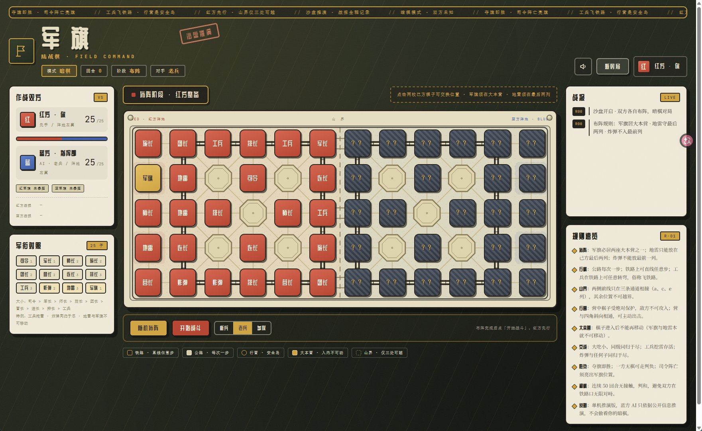

# 军旗 · 陆战棋（Military Flag）

一个纯前端的单机军旗（陆战棋）网页小游戏：暗棋对局、行营、铁路、工兵飞铁路、司令阵亡亮旗，蓝方由 AI 在**不确定信息**下推演。


> 交战中的棋盘：红方视角，蓝方未亮明的棋子显示为 `？？`。

## 特性

- **标准棋盘**：5 列 × 12 行（横向摆放为 12 × 5），10 座行营、4 座大本营、6 条铁路线（实现为 8 段直线），山界只在 a / c / e 三处相接
- **完整规则**：公路一步、铁路直线任意步、工兵可任意转弯飞铁路、行营内绝对保护且八向出入、大本营入内不可再动
- **暗棋对局**：敌方棋子以 `？？` 显示，只有交锋才亮明；司令阵亡后亮出己方军旗位置
- **单机 AI**：只依据公开信息做期望值推演 —— 已亮明的棋子、阵亡名单、"动过的棋子不可能是地雷/军旗"、"军旗只能在大本营"，**不会偷看你的暗棋**
- **三档难度**：新兵 / 老兵 / 参谋，难度影响算路噪声、风险权重与护旗意识
- **布阵阶段**：可自由交换己方棋子（自动校验军旗 / 地雷 / 炸弹的摆放约束），也可一键随机布阵
- **对局辅助**：悔棋（连 AI 的一步一起退）、参谋建议、认输、逐手战报、双方战损、结算统计
- **零依赖**：原生 HTML / CSS / JS，无构建步骤，可直接静态托管

## 快速开始

直接双击 `index.html` 即可游玩（字体走 Google Fonts，离线时自动回退到系统字体）。

或者起一个本地服务：

```bash
npm start          # http://localhost:3000
```

### 部署

纯静态资源，把仓库根目录发布到 GitHub Pages 即可（Settings → Pages → Deploy from a branch → `main` / `root`）。

## 界面导览



> 布阵阶段：红方 25 子已就位（军旗为金色棋子），蓝方全部以 `？？` 隐藏。

| 区域 | 内容 | 作用 |
| --- | --- | --- |
| 顶部滚动条 | 规则提示 | 循环展示核心规则要点 |
| 标题区 | 模式 / 回合 / 阶段 / 对手 | 四个状态芯片实时显示当前局面；右侧可切换音效、开新对局，并标明你执红方 |
| 左上「作战双方」 | 25 / 25 兵力条、军旗暴露状态、双方战损 | 兵力对比；司令阵亡后对应一方军旗会标记「位置暴露」 |
| 左中「军衔对照」 | 各兵种数量与大小顺序 | 常用规则速查 |
| 中列状态条 | 回合提示 + 操作说明 | 告诉你现在轮到谁、当前阶段该做什么 |
| 棋盘 | 12 × 5 沙盘 | 点击选子；亮点为可走格，红圈为可攻击目标，虚线框标出上一手 |
| 棋盘上方标注 | RED / 山界 / BLUE | 标明红蓝阵地与中间的山界 |
| 工具栏 | 阶段相关的按钮 | 布阵期随机布阵 / 开始战斗，交战期悔棋 / 参谋建议 / 认输 |
| 底部图例 | 铁路 / 公路 / 行营 / 大本营 / 山界 | 解释棋盘上的各种线条与符号 |
| 右上「战报」 | 带回合号的逐条记录 | 布阵调整、交锋结果、亮旗与胜负全部可追溯 |
| 右下「规则速览」 | 9 条规则摘要 | 不用离开页面就能查规则 |

### 操作速查

| 操作 | 效果 |
| --- | --- |
| 布阵期点击两枚己方棋子 | 交换位置；违反军旗 / 地雷 / 炸弹摆放规则时会提示 |
| 随机布阵 | 重新为红方生成一套合法阵型 |
| 开始战斗 | 结束布阵，红方先行 |
| 点击己方棋子 → 点击亮点 / 红圈 | 走子或发起攻击；敌方暗子交锋后双方身份公开 |
| 悔棋 | 退回红方上一次行棋之前（连同 AI 的应手一起撤销） |
| 参谋建议 | 高亮一步推荐走法；建议只依据公开信息，不偷看暗棋 |
| 认输 | 直接判蓝方获胜 |
| 再来一局 / 重开一局 / 新对局 | 重新布阵 |
| `Esc` | 取消当前选子 |
| 右上角喇叭按钮 | 开关音效（偏好会保存在本地） |

## 怎么玩

1. 布阵阶段：点击两枚己方棋子交换位置，确认后点「开始战斗」（红方先行）
2. 行棋阶段：点击己方棋子，亮点为可走位置，红圈为可攻击目标，再点目标格落子
3. 目标是夺取对方军旗，或让对手无棋可走

### 棋子与数量

| 棋子 | 数量 | 说明 |
| --- | --- | --- |
| 司令 | 1 | 最大，阵亡后己方军旗位置暴露 |
| 军长 | 1 | |
| 师长 / 旅长 / 团长 / 营长 | 2 / 2 / 2 / 2 | |
| 连长 / 排长 / 工兵 | 3 / 3 / 3 | 工兵是唯一能挖地雷的棋子 |
| 炸弹 | 2 | 与任何棋子同归于尽 |
| 地雷 | 3 | 不可移动，仅工兵可破 |
| 军旗 | 1 | 不可移动，被夺即败 |

大小顺序：司令 > 军长 > 师长 > 旅长 > 团长 > 营长 > 连长 > 排长 > 工兵；炸弹、地雷、军旗按上表特例处理。

### 布阵约束

- 军旗必须放在己方两座大本营之一
- 地雷只能放在己方最后两列
- 炸弹不能放在最前一列

### 交战判定

大吃小、同级同归于尽；炸弹与任何棋子同归于尽；工兵挖雷存活、其他棋子踩雷阵亡；任何棋子碰到军旗即夺旗获胜。

### 走子

- 公路：每次一步，可斜向进出**行营**
- 铁路：沿铁路直线任意步，不能越子，非工兵不能中途转弯
- 工兵：在铁路上可任意转弯（飞铁路）
- 行营：营内棋子不可被攻击，但可以主动出击
- 大本营：棋子可以进入，进入后不能再移动
- 山界：两侧前线只在 a、c、e 三列相通

### 胜负

- 夺取对方军旗即胜
- 一方无棋可走判负
- 连续 50 回合无接触判和（防止死局）

## 目录结构

```
index.html          页面结构
assets/style.css    沙盘风格样式
assets/favicon.svg
js/rules.js         棋盘几何、邻接图、走法、交战判定（纯逻辑）
js/engine.js        对局状态机：布阵、走子、战报、悔棋、胜负（纯逻辑）
js/ai.js            暗棋 AI：信念池、期望值、风险评估
js/render.js        SVG 棋盘绘制与界面渲染
js/app.js           交互、音效、回合调度
tests/run.js        规则回归测试（node，零依赖）
scripts/serve.js    本地静态服务器
```

## 测试

```bash
npm test
```

覆盖 56 项检查：棋盘邻接与山界通行、行营八向与保护、大本营、铁路直行与工兵转弯、阻挡、交战矩阵、300 次随机布阵合法性、悔棋、随机自对弈、AI 对弈终止性，以及"暗棋身份互换后 AI 决策不变"的信息公平性检查。

## 实现说明

**坐标转置**：标准棋盘的 5 列 × 12 行在这里转置为 12 列 × 5 行，`x` 为纵深（0 是红方大本营一侧），`y` 为横排。转置只影响显示，规则与参考实现等价。

**邻接图**：先铺常规四向公路，再断开第 6/7 行之间除 a、c、e 之外的所有边；行营额外与八个方向相连；大本营只保留"进入"的方向，走出去的边全部删除。

**铁路**：以 8 段直线描述，非工兵只能在"出发点所在的那几条线"上直行（`allowed` 集合），工兵则在铁路上做 BFS 任意转弯，两者遇子即停。

**AI**：维护一个"剩余未知棋子池"（全军 − 已亮明存活 − 已阵亡），按落点位置加权（大本营更可能是军旗、最后两列更可能是地雷、动过的棋子排除地雷/军旗），对每个候选走法计算交战期望收益、被反击的期望损失、护旗压力，以及随回合增长的进攻倾向。所有对敌子的推断都来自公开信息，没有读取真实棋子身份。

## 常见问题

- **为什么开局只能从山界进攻？** 一方 25 个可用格正好被 25 枚棋子填满，没有空格可走，因此首手只能沿 a / c / e 三处通道与对方接触。
- **蓝方棋子为什么是 `？？`？** 暗棋规则：只有交锋才亮明身份。战报会公开交战双方，战损栏也会记录已阵亡棋子的名称。
- **AI 会不会偷看我的棋子？** 不会。它只用已亮明的棋子、阵亡名单和"动过的棋子不可能是地雷/军旗"这类公开信息推演，测试里也专门验证了这一点。
- **为什么我方司令阵亡后军旗会被标出来？** 这是军旗规则：司令阵亡须向对手亮出军旗位置，界面上的「红军旗 位置暴露」就是提示。
- **连续 50 回合无接触会怎样？** 判和。这条兜底规则防止双方在铁路口长期对峙。
- **字体显示不对？** 页面优先使用 Google Fonts 的站酷庆科黄油体等字体，离线时自动回退到系统字体，不影响游玩。
- **怎么关声音？** 点右上角的喇叭图标；音量开关和对手难度都会记在本地。

## 参考与致谢

- 规则与棋盘几何参考了 [samuelyuan/online-junqi](https://github.com/samuelyuan/online-junqi)（MIT，Copyright © 2016 Samuel Yuan），本项目在同一套棋盘模型上做了转置实现与前端重构
- 字体：站酷庆科黄油体、Noto Serif SC、JetBrains Mono（Google Fonts）

## 许可

[MIT](LICENSE)
