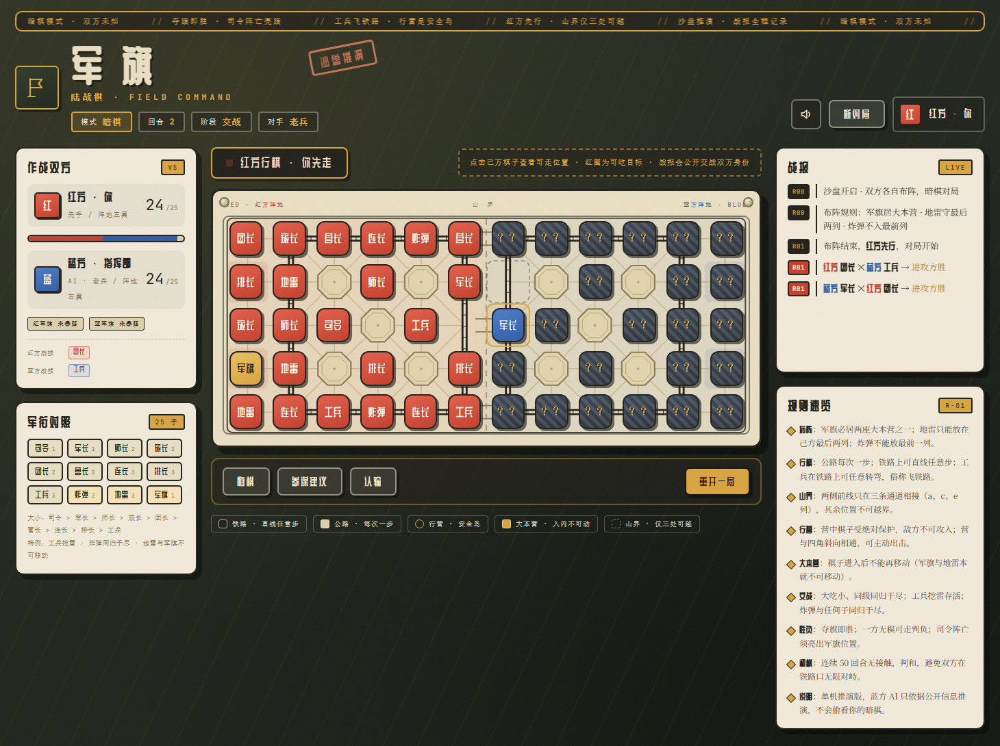

<div align="center">

# 🚩 军旗 · 陆战棋沙盘对决

**一个纯前端的单机军旗（陆战棋）网页小游戏**
—— 红方由你执子，蓝方 AI 在暗棋模式下推演；行营、铁路、工兵飞铁路、司令亮旗全部实现，战报全程记录。

     

**在线体验**：暂未部署（不会自动部署）· 本地运行见下方 👇

</div>

---

## ✨ 这是什么

<div align="center">



<p align="center">🎖️ 沙盘纸感 · 暗棋对决 · 夺旗即胜 —— 左侧战况、中央棋盘、右侧战报</p>

</div>

打开网页就能布阵开战：无需注册、无需后端、无数据库。棋盘按标准陆战棋 5 列 × 12 行转置成 12 × 5 横向摆放，几何与规则同参考实现等价，视觉沿用沙盘纸面风格。

| 模块 | 能力 |
|------|------|
| 🗺️ **标准棋盘** | 10 座行营、4 座大本营、8 段铁路线，山界只在 a / c / e 三处相接 |
| ⚔️ **完整规则** | 公路一步、铁路直线任意步、工兵飞铁路、行营八向保护、大本营入内不可动、炸弹 / 地雷 / 军旗特例 |
| 🌑 **暗棋对局** | 敌方棋子只显示 `？？`，交锋才亮明；司令阵亡后亮出己方军旗位置 |
| 🤖 **单机 AI** | 只依据公开信息推演 —— 已亮明棋子、阵亡名单、"动过的不是雷 / 旗"、"军旗只在大本营"，**不偷看你的暗棋** |
| 🎚️ **三档难度** | 新兵 / 老兵 / 参谋，影响算路噪声、风险权重与护旗意识 |
| 🧩 **布阵与辅助** | 交换己方棋子、随机布阵、悔棋、参谋建议、认输、逐手战报、双方战损、结算统计 |
| 🧱 **零依赖** | 原生 HTML / CSS / JS，无构建步骤；可直接双击 `index.html`，也可用一行命令起本地服务 |

---

## 🚀 快速开始

```bash
cd F:/UE/MilitaryFlag
npm start          # 打开 http://localhost:3000
```

> 需要 Node.js（仅用于本地静态服务，项目本身**零 npm 依赖**）。端口被占用可覆盖：`PORT=3001 node scripts/serve.js`。也可以直接双击根目录的 `index.html`。

### 部署

纯静态资源，把仓库根目录发布到 GitHub Pages 即可（Settings → Pages → Deploy from a branch → `main` / `root`）。

---

## 🎮 玩法与权限

1. **布阵**：点击两枚己方棋子交换位置，确认后点「开始战斗」（红方先行）；摆放不合规则会提示
2. **行棋**：点击己方棋子，亮点为可走位置，红圈为可攻击目标，再点目标格落子
3. **交锋**：大吃小、同级同归于尽；工兵挖雷、炸弹同归于尽；战报会公开交战双方身份
4. **提示**：猜不准时点「参谋建议」，它会按公开信息给一步推荐走法
5. **变数**：司令阵亡 → 己方军旗位置被公开；一方无棋可走 → 判负
6. **结算**：夺取对方军旗即胜，弹层展示回合数、交战次数与双方战损
7. **下一局**：点「再来一局」或「新对局」重新布阵；难度和音效偏好会保留在本地

### 权限模型

| 操作 | 布阵阶段 | 交战阶段 |
|------|:---:|:---:|
| 交换 / 随机重排己方棋子 | ✅ | ❌ |
| 走子 / 发起攻击 | ❌ | ✅（轮到红方时） |
| 悔棋（连 AI 应手一起退） | ❌ | ✅（轮到红方时） |
| 参谋建议 | ❌ | ✅（轮到红方时） |
| 认输 | ❌ | ✅ |
| 重开一局 / 新对局 | ✅ | ✅ |
| 查看对方暗子真实身份 | ❌ | ❌（交锋亮明后可见） |

### 边界情况

- **开局只能进攻**：25 枚棋子正好填满己方 25 个可用格，首手只能沿 a / c / e 三处山界与对方接触
- **行营**：营内棋子绝对安全，敌方不可攻入；但营与四角斜向相通，可主动出击
- **大本营**：棋子可以进入，进入后不能再移动
- **无棋可走**：轮到的一方判负；**连续 50 回合无接触**判和，避免铁路口无限对峙
- **刷新页面**：没有存档，刷新后重新布阵开新局

### 棋子与数量

| 棋子 | 数量 | 说明 |
|------|------|------|
| 司令 | 1 | 最大，阵亡后己方军旗位置暴露 |
| 军长 | 1 | |
| 师长 / 旅长 / 团长 / 营长 | 2 / 2 / 2 / 2 | |
| 连长 / 排长 / 工兵 | 3 / 3 / 3 | 工兵是唯一能挖地雷的棋子 |
| 炸弹 | 2 | 与任何棋子同归于尽 |
| 地雷 | 3 | 不可移动，仅工兵可破 |
| 军旗 | 1 | 不可移动，被夺即败 |

大小顺序：司令 > 军长 > 师长 > 旅长 > 团长 > 营长 > 连长 > 排长 > 工兵；炸弹、地雷、军旗按上表特例处理。

### 布阵约束

- 军旗必须放在己方两座大本营之一
- 地雷只能放在己方最后两列
- 炸弹不能放在最前一列

### 走子

- 公路：每次一步，可斜向进出**行营**
- 铁路：沿铁路直线任意步，不能越子，非工兵不能中途转弯
- 工兵：在铁路上可任意转弯（飞铁路）
- 山界：两侧前线只在 a、c、e 三列相通

---

## 🖼️ 界面一览

<div align="center">


<p align="center">🖌️ 布阵阶段：红方 25 子就位（军旗为金色棋子），蓝方全部以 <code>？？</code> 隐藏</p>

</div>

| 区域 | 内容 | 作用 |
|------|------|------|
| 🏠 顶部滚动条 | 规则提示 | 循环展示核心规则要点 |
| 🏷️ 标题区 | 模式 / 回合 / 阶段 / 对手 | 四个状态芯片实时显示局面；右侧可切换音效、开新对局 |
| 📊 左上「作战双方」 | 25 / 25 兵力条、军旗暴露状态、双方战损 | 兵力对比；司令阵亡后对应军旗标记「位置暴露」 |
| 📜 左中「军衔对照」 | 各兵种数量与大小顺序 | 常用规则速查 |
| ⏱️ 中列状态条 | 回合提示 + 操作说明 | 告诉你现在轮到谁、当前阶段该做什么 |
| 🎨 棋盘 | 12 × 5 沙盘 | 点击选子；亮点为可走格，红圈为可攻击目标，虚线框标出上一手 |
| 🧭 棋盘上方标注 | RED / 山界 / BLUE | 标明红蓝阵地与中间的山界 |
| 🧰 工具栏 | 阶段相关按钮 | 布阵期随机布阵 / 开始战斗，交战期悔棋 / 参谋建议 / 认输 |
| 🔑 底部图例 | 铁路 / 公路 / 行营 / 大本营 / 山界 | 解释棋盘上的线条与符号 |
| 💬 右上「战报」 | 带回合号的逐条记录 | 布阵调整、交锋结果、亮旗与胜负全部可追溯 |
| 📖 右下「规则速览」 | 9 条规则摘要 | 不用离开页面就能查规则 |

### 对局状态机

| phase | 含义 |
|-------|------|
| `setup` | 双方布阵中，可交换己方棋子 / 随机布阵 |
| `playing` | 红方与 AI 轮流行棋，交锋结算、亮旗与战报写入 |
| `over` | 夺旗 / 无棋可走 / 认输 / 判和，弹出结算层 |

### 关键设计

- **坐标转置**：标准 5 列 × 12 行在这里转置为 12 × 5，`x` 为纵深（0 是红方大本营），`y` 为横排；只影响显示，规则等价
- **邻接图**：先铺四向公路，断开第 6/7 行之间除 a、c、e 之外的所有边；行营补八向；大本营只保留"进入"方向
- **铁路**：8 段直线；非工兵只能在"出发点所在线段"直行，工兵做 BFS 任意转弯，两者遇子即停
- **AI 信念池**：全军 − 已亮明存活 − 已阵亡；大本营位置加权军旗、最后两列加权地雷、动过的棋子排除雷 / 旗；按交战期望、被反击风险、护旗压力与进攻倾向打分，全程不使用对方真实身份
- **逻辑与渲染分离**：`rules.js` / `engine.js` / `ai.js` 不碰 DOM，可直接在 Node 里跑规则回归测试

---

## 📂 目录结构

```
F:/UE/MilitaryFlag/
├── index.html                # 页面结构
├── assets/
│   ├── style.css             # 沙盘纸感样式
│   └── favicon.svg
├── js/
│   ├── rules.js              # 棋盘几何、邻接图、走法、交战判定（纯逻辑）
│   ├── engine.js             # 对局状态机：布阵 / 走子 / 悔棋 / 胜负（纯逻辑）
│   ├── ai.js                 # 暗棋 AI：信念池、期望值、风险评估
│   ├── render.js             # SVG 棋盘绘制与界面渲染
│   └── app.js                # 交互、音效、回合调度
├── docs/
│   ├── preview.png           # 交战画面截图
│   └── screenshot-setup.jpg  # 布阵阶段截图
├── scripts/
│   └── serve.js              # 零依赖本地静态服务器
├── tests/
│   └── run.js                # 规则回归测试（node，零依赖）
├── package.json
├── .gitignore
├── LICENSE / NOTICE
└── README.md                 # 本文件
```

---

## 🧪 测试

```bash
npm test        # 56 项检查，零依赖
```

| 覆盖项 | 内容 |
|--------|------|
| 🗺️ 棋盘几何 | 山界仅三处通行、行营八向与保护、大本营只进不出、普通格四向 |
| 🚆 走法 | 铁路直行、工兵飞铁路、遇子即停、斜进斜出、不可移动棋子 |
| ⚔️ 交战与布阵 | 交战矩阵、300 次随机布阵合法性、军旗 / 地雷 / 炸弹位置约束 |
| 🔁 对局流程 | 悔棋、随机自对弈、AI 对弈能正常终止 |
| 🤖 AI 公平性 | 只交换两枚暗棋身份后，AI 决策不变（验证未偷看真实棋子） |

浏览器端还跑过 45 手随机对局的端到端冒烟测试，`window.onerror` 零报错。

---

## 📖 已知限制

- **单机推演**：没有联机对战，蓝方固定由 AI 接管
- **没有存档**：刷新页面即重新布阵开新局
- **悔棋范围**：只退回红方上一次行棋之前（连 AI 应手），不能回退到任意历史步
- **字体依赖网络**：优先加载 Google Fonts，离线时回退到系统字体，不影响游玩
- **单房间概念**：不涉及账号、房间号与跨设备同步

---

## 🙏 参考与致谢

- 规则与棋盘几何参考了 [samuelyuan/online-junqi](https://github.com/samuelyuan/online-junqi)（MIT，Copyright © 2016 Samuel Yuan），本项目在同一套棋盘模型上做了转置实现与前端重构
- 字体：站酷庆科黄油体、Noto Serif SC、JetBrains Mono（Google Fonts）

## 📄 许可

[MIT](LICENSE)
